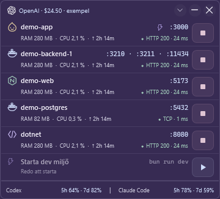

# Otter Monitor


En liten Windows-app för lokala utvecklingsportar och snabbstarter. Byggd i C# / .NET 10 med WPF. Engelskt eller svenskt, minimalistiskt gränssnitt med Bricolage Grotesque, frostat glas, dämpade plommonfärger, ljusblå accenter och diskreta stoppknappar. Port- och processlogiken har inga externa bibliotek; appens Billing-session använder Microsofts officiella WebView2-SDK.

## Installera

### Nytt i 1.7

1.7.7 öppnar lokala webblänkar med `localhost` som standard. Under **Inställningar → Allmänt → Webbadress** finns radioval för localhost, IPv4 (`127.0.0.1`), IPv6 (`[::1]`), datorns nätverks-IP och upptäckt IP-adress. Val utan kompatibla tjänster är nedtonade. Adressen verifieras innan webbläsaren öppnas; om tjänsten inte svarar via ditt val används en annan verifierad adress. Valet sparas och gäller även kopierade webbadresser.

1.7.6 visar Codex och Claude Code även när deras appar och CLI:n är stängda. Codex hittar installerade native-klienter, inklusive T3:s medföljande klient, utan att en Codex-process behöver köras. Enbart Codex CLI och dess befintliga inloggning räcker. Claudes anslutna kontosida uppdateras oberoende av Claude-appen; terminalens statusrad finns kvar som alternativ.

1.7.5 ger API-saldona jämna mellanrum och gemensam höjd för ikoner och text, så att alla tre leverantörer ligger i linje.

1.7.4 samlar API-ikoner och saldon tätt till vänster. Ledigt utrymme hamnar efter saldona så att bredare fönster inte ökar mellanrummen mellan leverantörerna. Äldre saldon markeras med en liten gul punkt i stället för text i överraden; detaljer finns kvar i muspekartipset.

1.7.3 rättar Codex-kvoten för Microsoft Store-installationen och T3:s medföljande CLI. OpenAI- och JEV-saldon håller sidrenderingen aktiv även när Billing-fönstret är dolt. OpenAI-läsaren stöder saldokortets intilliggande köp-länk, och JEV stöder även den nya adressen `/billing`. API-raden visar leverantörernas ikoner, belopp och status utan namn, oavsett fönsterbredd; namn finns kvar i muspekartips och tillgänglighetsnamn.

1.7.1 rättar Anthropics Google-inloggning: Googles popup får en riktig WebView2-barnvy med samma profil och bevarad `window.opener`, i stället för att ersätta Billing-sidan. Återkoppling med `postMessage`, start från `about:blank` och automatisk stängning testas med lokala syntetiska sidor; testet använder inga riktiga inloggningsuppgifter.

1.7.2 läser totalsaldot från Claude Consoles monetära Billing-länk i sidhuvudet. Den aktuella layouten visar köpta och kampanjkrediter separat i saldokortet; appen använder Anthropics eget totalsaldo och summerar inte belopp från fakturor eller kampanjtabellen. Kampanjkrediter kan vara begränsade till vissa modeller och produkter. Den äldre enkla saldokortslayouten stöds fortfarande. En misslyckad avläsning utan tidigare saldo visas som **unavailable** i stället för **waiting**.

Claude Console kräver en aktiv renderer för att ladda kontovärden. Anthropic-vyn håller därför sin renderer aktiv i ett dolt värdfönster; inget webbläsarfönster behöver visas för avläsningen. Den dolda vyn får också en normal skrivbordsyta redan före första visningen. Både realistiska, syntetiska Billing-sidor och en avläsning med befintlig inloggning har verifierats.

- Gränssnittet använder det medföljande Bricolage Grotesque (12pt, optimerat för liten text), med svenska tecken. Ingen separat typsnittsinstallation behövs. Licensen finns i `licenses/BricolageGrotesque-OFL.txt` och följer med den publicerade appen.
- Engelska är standardspråk. Välj **Settings → General → Language → Svenska** för svenska. Språkvalet börjar gälla nästa gång appen öppnas; avsluta via menyn och starta igen, eftersom krysset normalt bara döljer fönstret.
- **API balances / API-saldon** och **Coding assistants / Kodassistenter** har egna kort under Synlighet. API-saldona ligger kvar i den kompakta överraden med loggor, inklusive Claude-symbolen för Anthropic API. Stoppknapparna är mindre (28 × 24).
- **Anthropic API** visar kontots kvarvarande USD-krediter från `platform.claude.com/settings/billing` (även den äldre `console.anthropic.com`-adressen stöds). Klicka på Anthropic API och öppna Billing för att logga in och välja organisation. Ingen modellförfrågan eller API-nyckel behövs. Saldoavläsningen uppdateras ungefär var femte minut i appens egen WebView2-profil, `anthropic-profile`. Sessionscheckpointen `anthropic-session.bin` krypteras med Windows DPAPI och är separat från Claude Code, OpenAI och JEV. En oläsbar sida behåller det senaste saldot som äldre; appen gissar aldrig kvarvarande krediter från förbrukningen. Ändrad Billing-layout kan kräva en uppdaterad läsare.
- Färgdialogen har en **skärmpipett** bredvid HEX-fältet. Klicka på pipetten och sedan på en pixel på skärmen. **Esc** avbryter. HEX, RGB och förhandsvisningen uppdateras tillsammans, och **Spara/Avbryt** fungerar som tidigare. Skärmbilden används bara i minnet medan pipetten är aktiv och sparas eller skickas inte.

Kontrollera Anthropic-läsaren med `node --test tests/AnthropicBalanceReader/reader.test.cjs`. Den syntetiska WebView2-kontrollen körs med `OtterMonitor.exe --verify-anthropic-background --test-root <egen testmapp> --report <rapportfil>` och kontaktar inget konto. Förhandsvisningar är engelska som standard; lägg till `--swedish` för svenska eller `--anthropic-balance-dialog` för anslutningsdialogen.

Interaktiva förhandsvisningar med `--preview --stay-open` använder verkligt Windows-glas, även i Inställningar och färgdialogen. PNG-exporter visar fortfarande reservytan eftersom WPF:s bildrendering inte fångar DWM-effekten.

Kör `installer.ps1`. Den bygger appen och skapar **dist/OtterMonitor-Setup-<version>.exe** med [Inno Setup 6](https://jrsoftware.org/isinfo.php) (installera en gång med `winget install --id JRSoftware.InnoSetup -e --scope user`). Installern:

- installerar för dig utan administratörsfråga, i `%LOCALAPPDATA%\Programs\Otter Monitor`, och lägger **Otter Monitor** i Start-menyn,
- syns under **Inställningar → Appar** med version och avinstallation,
- kan lägga en skrivbordsgenväg och starta Otter Monitor dolt i systemfältet vid inloggning (`--tray`),
- uppdaterar en befintlig installation på plats: en körande Otter Monitor avslutas först med `OtterMonitor.exe --exit`; startade snabbstarter fortsätter köras,
- lämnar datamappen `%LOCALAPPDATA%\OtterMonitor` kvar vid avinstallation, så att inställningar och inloggningar finns kvar vid en ny installation.

Versionen sätts i `Directory.Build.props`. Utan installation fungerar också `build.ps1`, som bara bygger den portabla **app/OtterMonitor.exe**. Den innehåller .NET och kan köras direkt som vanlig användare. En andra instans öppnas inte; den visar i stället fönstret som redan körs.

## Starta

1. Portlistan uppdateras automatiskt varannan sekund. **Bara utveckling** visar välkända runtime-processer som Node, Bun, Deno, Python och .NET samt Docker-portar. Avmarkera för att se alla lokala lyssnande TCP-portar.
2. Varje **process eller container visas som en grupp** med sina unika portar på samma rad. IPv4- och IPv6-bindningar för samma port visas en gång i sammanfattningen. Dubbelklick på en Node/Bun/Deno-tjänst som svarar över HTTP öppnar webbporten i standardwebbläsaren. Övriga tjänster öppnar en terminal i projektmappen. Håll musen över raden för detaljer och **snabbknappar** (se Öppna projektet).
3. Gruppens **stoppknapp** visar vilken process eller container och vilka portar som berörs innan stoppet utförs.
4. **Snabbstarter ligger i samma lista som portarna.** Lägg till en via **⌄ → Ny snabbstart…**. Dialogen söker igenom dina projektmappar (som standard `C:\repos` och andra vanliga kodmappar som finns, eller de mappar du väljer med mappknappen) och listar projekt som går att starta. Välj ett projekt och ett av dess kommandon så fylls namn, arbetsmapp och kommando i; allt går att ändra innan du sparar, och dubbelklick sparar direkt med det föreslagna kommandot. Projekt som redan har en snabbstart märks **tillagd**. Du kan också fylla i mapp och kommando själv, exempelvis `bun run dev`. En snabbstart som inte har någon öppen port visas nedtonad under portarna med **▶**. När kommandot körs och dess process lyssnar flyttar den upp som en vanlig portrad med en liten blixt (⚡) bredvid namnet. Stopp, omstart och logg på den raden gäller då hela snabbstarten. Högerklick på en snabbstartsrad ger start, omstart, logg, redigera, terminal och editor. **⌄ → Hantera snabbstarter…** öppnar fortfarande det separata fönstret med alla kort. Nya installationer börjar med en tom snabbstartslista.
5. **Lägg till** och **Redigera** hanterar namn, arbetsmapp och kommando. Kommandon körs i bakgrunden via `cmd.exe /d /s /c`; exempelvis `bun run dev`, `npm run dev`, `dotnet watch` eller `docker compose up -d`.
6. **Logg** visar kommandots utdata i ett eget fönster: namn, kommando och mapp överst med körstatus, rader i monospace där fel visas rosa, varningar gula och lyckade steg (✓, ready) gröna, och tidsstämplar och `[verktyg]`-prefix nedtonade. Loggen följer slutet tills du rullar upp; då visas **↓ Till slutet**. **Ctrl+F** filtrerar rader, rader kan markeras och kopieras (Ctrl+C), **Visa fil** öppnar loggfilen i Utforskaren, och för snabbstarter finns **Starta om** och **Stoppa** direkt i fönstret. Appen har endast den kompakta portöversikten, även när äldre inställningar anger standardläge. Den är 360 px bred, med minst tre grupprader och 10 px indrag till vänster. Höjden följer listan upp till 342 px, sedan scrollas portarna. Namn och portar delar rad; status, RAM, CPU och körtid visas under. Överraden har klickbart OpenAI-saldo, dragyta, **⌄**, minimera och stäng. Menyn innehåller bara uppdatering, utvecklingsfilter, fäst överst, snabbstarter och filter, följt av Inställningar och Avsluta. Editor, notiser, systemfält och utseende finns i inställningsfönstret. Codex/Claude ligger kvar i botten medan portarna scrollas.
7. **Omstartsikonen** bland radens snabbknappar startar om en Docker-container eller en snabbstart. På snabbstartskortet finns samma ikon bredvid Redigera; den aktiveras när kommandot körs. Omstart avslutar hela den tidigare processgruppen innan kommandot körs igen. En öppen loggvy följer med till den nya körningen och äldre loggar bevaras.
8. Körande snabbstarter **återansluts automatiskt** när Otter Monitor öppnas igen och får statusen ”återansluten”. Starta-knappen blir Stoppa, och samma snabbstart kan inte startas dubbelt. Återanslutningen gäller körningar som startats med den här versionen av Otter Monitor.
9. **Bekräftelser** som "Kopierade …", "Öppnade terminal …" eller "Stoppade …" visas som en liten ruta längst ned i listan i tre sekunder och tar aldrig emot klick. Problem, till exempel ett upptaget urklipp, får en varningsikon och visas i fem sekunder. Fel som kräver ett beslut visas fortfarande som dialog. När inget körs visar listan uttern, en kort förklaring och knappen **Ny snabbstart**; döljer utvecklingsfiltret andra portar säger förklaringen det.
10. **Börja skriva** var som helst i fönstret, eller tryck **Ctrl+F**, för att filtrera. Filtret matchar namn, port, PID, runtime, projektmapp och snabbstartens namn, kommando och mapp. En sökning letar bland alla lyssnande portar, även utanför **Bara utveckling**. **↓** går till listan, **Enter** öppnar första träffen och **Esc** rensar filtret.
11. **Krysset döljer fönstret till systemfältet** och Otter Monitor fortsätter bevaka. Klick på ikonen eller **Win+Shift+O** visar och döljer fönstret. Om Win+Shift+O redan används av ett annat program används **Ctrl+Alt+O**; ikonens tips visar vilket. Avsluta via **⌄ → Avsluta Otter Monitor** eller högerklick på ikonen. Stäng av **⌄ → Inställningar → Allmänt → Stäng till systemfältet** för att krysset ska avsluta appen som tidigare. Startas Otter Monitor igen visas det redan öppna fönstret.

Inställningar och loggar sparas i `%LOCALAPPDATA%\OtterMonitor`. `settings.json` innehåller snabbstarterna och kan redigeras när appen är stängd. Föregående inställningsfil sparas som `.bak`. En trasig fil skrivs inte över vid inläsning. Loggfilerna ligger i `logs`; loggvyn visar de senaste 64 kB, hela filen bevaras. `sessions` sparar kopplingen mellan varje snabbstart och dess processgrupp. Behåll dessa filer medan miljöer körs.

## Hitta projekt

Sökningen läser bara projektfiler och kör inget. Den går högst fyra nivåer ned och hoppar över `node_modules`, `bin`, `obj`, `dist`, `build`, dolda mappar som `.git`, `.next` och `.output`, samt länkar.

- **`package.json`** med `scripts`: namnet är paketets `name`, utom vanliga mallnamn som `nuxt-app` eller `vite-project`, där mappnamnet används. Kommandot följer pakethanteraren enligt `packageManager` eller låsfilen, även i en överliggande arbetsyta: `bun run`, `pnpm run`, `yarn` eller `npm run`. `dev`, `start`, `serve`, `develop`, `watch` och `preview` visas först och den första föreslås; därefter andra skript som liknar en server, sist övriga. Livscykelskript som `postinstall` och `pre`/`post`-krokar visas inte.
- **Compose-filer** (`compose.yaml`, `docker-compose.yml`): `docker compose up -d`, `up` eller `up --build`.
- **.NET-webbprojekt** (`Microsoft.NET.Sdk.Web`): `dotnet watch` eller `dotnet run`. Klassbibliotek och testprojekt visas inte.
- **Deno** (`deno.json` med `tasks`): `deno task …`. **Django** (`manage.py`): `python manage.py runserver`.

## Öppna projektet

**Dubbelklick på en Node/Bun/Deno-rad** öppnar dess lokala webbport i din standardwebbläsare när porten lämnar ett verifierat HTTP-svar. Processens portägarskap och HTTP-svar kontrolleras igen vid klicket. Om gruppen har flera webbportar väljs den med lägst portnummer. Debugger- och HMR-portar väljs inte. HTTP-felsidor kan också öppnas; ett svar som 404 eller 500 är fortfarande en webbsida. Inställningen **Webbadress** styr adresstypen, med localhost som standard för loopback. HTTP eller HTTPS och porten behålls enligt statuskontrollen.

Om tjänsten saknar ett verifierat HTTP-svar, eller kör en annan runtime, öppnar dubbelklick en ny terminal i projektmappen. Enter på en fokuserad rad gör samma sak. Windows Terminal används när den är tillgänglig, annars öppnas Windows PowerShell. Terminalen kopplas inte till en redan körande extern process och startar inte om servern.

**Håll musen över en rad**, eller markera den med ett klick eller piltangenterna, så ersätts resursraden av snabbknappar: 🌐 webbläsare (för webbruntimes), terminal, editor, kopiera adress, logg (snabbstart eller Docker) och omstart (snabbstart eller Docker). Resurserna finns kvar i muspekartipset. Radens höjd ändras inte.

**Högerklick** ger hela uppsättningen: **Öppna i webbläsaren**, **Kopiera http://localhost:3000** (den verifierade adressen när HTTP svarat, annars första porten), **Kopiera PID** eller **Kopiera container-ID**, **Öppna terminal i projektmappen**, **Öppna i editor**, **Visa logg**, **Starta om** och **Stoppa…**. Det uttryckliga webbläsarvalet öppnar aldrig en terminal som reserv. Radens stopp- och omstartsknappar är separata från dubbelklicket.

**Editor** väljs under **⌄ → Inställningar → Allmänt → Editor**: Zed, VS Code, Cursor eller Rider. Utan eget val används den första installerade i den ordningen, så befintliga Zed-användare märker ingen skillnad. Editorer som inte hittas är gråade. Varje editor startas direkt via sin egen .exe med projektmappen som enda argument, aldrig via ett shell eller en `.cmd`-fil; VS Code och Cursor hittas i sina vanliga installationsmappar eller via deras startskript i PATH. Editorns egen inställning avgör om projektet öppnas i ett nytt eller befintligt fönster.

**Visa logg** för en Docker-container visar `docker logs --tail 400` och uppdateras varannan sekund. Containerns stdout och stderr sorteras ihop efter Dockers tidsstämplar och färgkoder tas bort. Varje snabbstart och container har ett loggfönster; att be om det igen tar fram det öppna.

För Node/Bun/Deno används den identifierade projektmappen. För andra Windows-processer läses arbetsmappen när du öppnar raden, med kontroll av processens starttid. Docker Compose kan använda containerns etikett `com.docker.compose.project.working_dir` när den pekar på en befintlig lokal Windows-mapp. Om projektmappen saknas visas ett meddelande; ingen godtycklig mapp öppnas.

Integrationerna använder [Windows Terminals kommandoradsgränssnitt](https://learn.microsoft.com/en-us/windows/terminal/command-line-arguments) och respektive editors kommandorad. Sökvägar skickas som separata argument, utan att byggas in i shellkommandon.

## Status och resursvärden

Typetiketter som NODE, DOCKER och TCP har ersatts med små vektorikoner. Håll musen över ikonen för typens namn. Projektnamnen och grupperingen per faktisk process eller container behålls.

Varje grupp visar status med svarstid samt **RAM**, **CPU** och **↑ körtid**. RAM/CPU för Windows-processer mäts varannan sekund för processens verifierade PID och starttid. RAM är arbetsminnet; CPU visar andelen av datorns totala logiska processorkapacitet mellan två mätningar. Det första CPU-värdet är därför `—`. Värdena gäller portens ägarprocess, inte andra processer i projektet.

För Docker används `docker stats --no-stream --no-trunc` ungefär var tionde sekund mot samma lokala motor som portavläsningen. CPU och minne följer Dockers värden; CPU kan överstiga 100 % med flera kärnor. Saknade värden visas som `—` utan att portlistan försvinner. Körtid räknas från processens eller containerns verkliga starttid och följer med en omstart.

Status kontrolleras i bakgrunden ungefär var tionde sekund. Varje unik lokal TCP-port får en anslutningskontroll. Vanliga webbtjänster får också `HEAD /`; om servern svarar 405 provas `GET /` tills svarshuvudena har kommit. Svaret visas som exempelvis **HTTP 200 · 24 ms** eller **HTTP 500 · 61 ms**. Omdirigeringar följs inte. Ingen kropp hämtas och ingen inloggning eller cookie skickas. Endast lokala IP-adresser används; HTTPS-certifikat kringgås inte. Kända debugger- och HMR-portar kontrolleras enbart med TCP.

Grönt betyder att alla kontrollerade TCP-portar svarar och HTTP inte rapporterar fel. HTTP 4xx visas gult och 5xx rött; en 404 på `/` betyder att just den sökvägen saknas och behöver inte betyda att hela applikationen är trasig. **TCP** bekräftar en anslutning, inte applikationens hälsa. Om några portar inte svarar visas exempelvis **1/2 svarar**. Svarstiden är den långsammaste lyckade kontrollen i gruppen; detaljer för varje port finns i muspekartipset. Docker health-statusen `unhealthy`, `starting` eller `paused` visas när den finns. UDP har ingen TCP-svarstid och visas neutralt utan en Docker health-kontroll. Efter 30 sekunder utan ny status visas **Äldre**. En rad med fel får dessutom en svag rosa ton, så att problemet syns utan att läsa statustexten. Raderna byter aldrig plats efter status, så att en knapp inte flyttas under muspekaren. Misslyckade snabbstarter markeras på samma sätt.

## Codex och Claude Code

Under portlistan visas **procent kvar av abonnemangets kvot** för Codex och Claude Code, oavsett om du använder officiella appar, enbart CLI eller T3 Code. Båda visas även när assistentprogrammen är stängda. Dölj en rad under Inställningar → Synlighet om du inte vill se den. Håll musen över för hela kvoten, senaste mottagningstid och återställningstider i lokal tid. Låg återstående kvot markeras rosa. Avsaknad av en kvot innebär inte 0 % förbrukning.

**Codex** använder den installerade Codex-klientens dokumenterade [account/rateLimits/read](https://learn.chatgpt.com/docs/app-server) med klientens befintliga inloggning. Otter Monitor hämtar ungefär varje minut även när Codex och T3 är stängda. Enbart ett installerat och inloggat Codex CLI räcker; native-installationer, npm, T3:s medföljande klient och Microsoft Store-appens native-klient söks även utan körande processer. Klicka på raden för att läsa igen. Ingen modellkörning startas och inga nycklar kopieras. Namngivna kvoter och de tidsfönster kontot faktiskt lämnar används; vissa konton lämnar exempelvis bara en veckokvot. CLI:ns tillfälliga läsprocess stängs efter anropet.

**Claude Code** kan läsa kontots kvot även utan den officiella skrivbordsappen. Klicka på Claude Code-raden längst ned och logga in med **samma Claude-konto som i CLI:t eller T3**. Otter Monitor öppnar sin egen WebView2-session på [Settings > Usage](https://claude.ai/settings/usage) och läser de synliga procentfälten för aktuell session och veckans gräns för alla modeller. Dölj fönstret när du är klar. Den dolda sidan uppdateras ungefär varje minut även när Claude och T3 är stängda; ingen extra modellförfrågan görs. Detta är en separat kontoinloggning, inte återanvändning av Claude CLI:ts autentiseringsuppgifter. Användningen gäller kontot, inte en enskild Code-session.

Inloggningen använder en separat lokal profil (`claude-profile`). Sessionscookies sparas krypterat med Windows DPAPI i `claude-session.bin` och återställs vid nästa appstart; vanliga cookies sparas av WebView2. Den lokala checkpointen gäller högst sju dagar, och Claude kan kräva ny inloggning tidigare. Inga uppgifter kopieras från den installerade Claude-appen eller din vanliga webbläsare. **Koppla från** tar bort sessionens cookies och checkpoint och stänger av avläsningen. Kvotraden finns kvar med möjlighet att ansluta igen. Saknade, tvetydiga och oläsbara procentfält visas som saknade eller äldre värden. Ändringar i webbplatsens layout eller språk kan kräva en uppdatering av läsaren. Återställningstider visas bara om sidan lämnar en entydig maskinläsbar tid.

Claudes användningssida kan öppnas som en inställningsdialog medan sidans interna adress ändras till `/new`. Otter Monitor läser då bara den synliga dialogen med planens sessions- och veckokvot, aldrig procenttext i chatten. Bakgrundsuppdateringen öppnar användningssidan igen i stället för att ladda om chatten.

**Claude Code i terminalen** kan också använda det dokumenterade [rate_limits-fältet i statusraden](https://code.claude.com/docs/en/statusline), med 5-timmars- och 7-dagarsfönster när kontot lämnar dem. Kör `OtterMonitor.exe --install-claude-usage` en gång för detta alternativ. Otter Monitor lägger till sin statusrad i `~/.claude/settings.json` (eller `CLAUDE_CONFIG_DIR`) och sparar en backup bredvid filen. Övriga inställningar bevaras. En befintlig egen statusrad skrivs inte över. Den nya statusraden visar samma återstående kvot i terminalen.

Första Claude-värdet kommer efter ett vanligt svar som innehåller kvotdata. Otter Monitor skickar inga Claude-anrop för att få fram det. Claude-kopplingen fungerar utan webbläsare eller separat inloggning; den läser bara JSON som Claude Code själv lämnar till statusraden. Endast procent, tidsfönster, återställningstid och mottagningstid sparas i `%LOCALAPPDATA%\OtterMonitor\claude-usage.json`. Konversationer, transcript-sökvägar och autentiseringsuppgifter sparas inte. Scriptet ligger bredvid cachefilen som `claude-usage.ps1` och fungerar även när Otter Monitor är stängt. En koppling gäller alla vanliga sessioner som använder den användarinställningen; projektspecifika statusrader kan åsidosätta den. Vid flera konton/sessioner används den senast mottagna kvoten.

Claude-värden äldre än fem minuter och Codex-värden äldre än två minuter markeras **äldre**. När en återställningstid har passerat visas `—` tills ett nytt värde kommer, inte en påhittad full kvot. Saknad Claude-kvot i terminalen kan bero på kontotyp, en äldre klient eller att klienten ännu inte lämnat fältet. Se då Claude Codes egen `/usage`. Windows-installationer stöds; CLI:n som bara finns inne i WSL/fjärrmaskiner används inte. När Claudes kontosida är ansluten används den för raden; annars används statusradens cache om bryggan är installerad.

Koppla bort med `OtterMonitor.exe --remove-claude-usage`. Det tar bara bort Otter Monitors egen statusrad och lämnar senare inställningsändringar kvar. Om du redan har en egen statusrad behöver du välja vilken du vill använda; Otter Monitor ersätter eller slår inte ihop den automatiskt.

Kvoterna är separata från **OpenAI API-saldot i USD**. Båda visas samtidigt. I kompaktläget ligger **Codex till vänster och Claude Code till höger på samma fasta bottenrad**, med `|` mellan dem när båda körs. **När bara ett program körs fyller dess rad hela bredden**, med namn till vänster och kvot till höger. Bara portlistan scrollas. Håll musen över respektive kvot för fullständig information och återställningstider. Bottenraden ligger kvar även när fönstret ändrar storlek. Om inget program körs tar den ingen plats; portlistan behåller minst tre rader även när båda kvoterna visas.

## OpenAI-saldo

Saldot visas i överraden. **Både OpenAI-loggan och beloppet är klickbara** och öppnar saldokopplingen. Den tomma ytan bredvid fungerar som dragyta. Den vanliga appen läser det sparade saldot från din egen Billing-session; saknade värden visas som väntande. Designförhandsvisningar märks uttryckligen **exempel** och läser inga konton. Saldoknappen öppnar då en informationsdialog med kontofunktionerna avstängda.

Kompaktlägets stoppknappar har en diskret kontursymbol utan färgad platta i viloläget. Rosa markering visas när musen hålls över knappen utan extra fokusram eller tryckmarkering. Knapparna är 28 × 24 px med mindre padding. Knappen stoppar hela processgruppen efter bekräftelse.

### Egen session i bakgrunden

1. Välj **Logga in / Öppna Billing**. Otter Monitor öppnar ett eget Billing-fönster med en separat WebView2-session.
2. Logga in på OpenAI och välj rätt organisation. Ingen inloggning, cookie eller token kopieras från Chrome, Edge, Brave eller Codex.
3. När saldot har lästs, välj **Dölj** eller använd Billing-fönstrets kryss. Fönstret försvinner men sessionen fortsätter i bakgrunden. **Dina vanliga webbläsare kan vara helt avstängda.** Även ett minimerat Billing-fönster kan uppdateras.

Billing hämtas på nytt var femte minut när fönstret är dolt eller minimerat och ingen inmatning/dialog är öppen. Ett synligt Billing-fönster eller en pågående inloggning avbryts inte. **Uppdatera saldo nu** hämtar ett nyare saldo direkt. Oförändrad text som bara läses på nytt får inte en förnyad avläsningstid.

**Otter Monitor måste vara igång**, men kan vara minimerat. När Otter Monitor stängs avslutas också dess Billing-session; nästa start återupptar bakgrundsläsningen om den var aktiverad. Ingen Windows-tjänst eller autostart skapas. WebView2:s profil finns i `%LOCALAPPDATA%\OtterMonitor\billing-profile`.

För att inloggningen ska kunna återställas även efter en fullständig omstart sparar appen också sin egen OpenAI-sessions cookies i `billing-session.bin`, krypterat med Windows DPAPI för din Windows-användare. Detta sker först när ett saldo har lästs, därefter ungefär varje minut och vid vanlig avstängning. Återställningen sker före sidladdningen; befintliga nyare cookies ersätts inte. Endast sessionens OpenAI-domäner ingår. Cookie-egenskaperna bevaras och serverns giltighetstid ändras inte. Ett lokalt checkpoint äldre än sju dagar återställs inte. Inga lösenord sparas eller loggas och inga andra webbläsarprofiler läses.

När sidan återgår till inloggning raderas den sparade sessionen. **Koppla från** stoppar läsaren och raderar `billing-session.bin`, men behåller WebView2-profilen. OpenAI kan fortfarande avsluta eller kräva ny verifiering av en session; öppna då Billing via **OpenAI-loggan** och logga in igen. Efter uppdatering från versionen utan sessionslagring behöver du logga in en gång och vänta tills saldot visas.

Microsoft Edge WebView2 Runtime krävs. Den finns redan på många Windows-datorer; om den saknas visar appen ett fel och portfunktionerna fortsätter fungera. Runtime kan hämtas från [Microsofts officiella sida](https://developer.microsoft.com/en-us/microsoft-edge/webview2/). SDK-licens och NOTICE följer med under `licenses`.

Bakgrundsläsning, dold omhämtning och återställning efter fullständigt avslutad app och WebView2-process verifieras med egna lokala testdata. OpenAI eller din inloggningsleverantör kan kräva ytterligare verifiering eller neka en inbyggd webbläsare; öppna då Billing-fönstret igen.

## JEV-saldo

**JEV** visas bredvid OpenAI-saldot i överraden och visar dina återstående pengar hos TypeSafe i USD. Klicka på **JEV · koppla**, välj **Logga in / Öppna Billing** och logga in på rätt konto och organisation. Appen läser bara beloppet under **Available credits** på [TypeSafe Billing](https://console.typesafe.ai/settings/billing), inte belopp från betalningshistoriken eller kostnaden för enskilda anrop. Noll kronor/dollar skiljs från saknade data.

JEV använder en egen WebView2-profil (`jev-profile`), separat från OpenAI, Claude och din vanliga webbläsare. Efter inloggningen kan du dölja Billing-fönstret med **Dölj** eller krysset. Den dolda eller minimerade sidan uppdateras ungefär var femte minut medan Otter Monitor körs. En synlig sida, pågående inmatning eller extra betalningsdialog laddas inte om automatiskt. TypeSafes vanliga Settings-dialog får vara öppen, eftersom själva Billing-sidan visas där.

Saldot och senaste avläsningstiden sparas i `jev-balance.json`. Sessionscookies för TypeSafe sparas i `jev-session.bin`, krypterat med Windows DPAPI; checkpointen gäller högst sju dagar och servern kan kräva ny inloggning tidigare. Beständiga cookies sparas av WebView2. **Koppla från** stoppar avläsningen och tar bort checkpointen, men behåller webbläsarprofilen. OpenAI och Claude påverkas inte. Om inloggningen går ut eller fältet inte kan läsas markeras det senaste saldot som **äldre**. Öppna då JEV Billing igen. Inga modellförfrågningar görs för saldoavläsningen.

## Inställningar och synlighet

Öppna **⌄ → Inställningar…** för en egen vy med samma färg, glas och rundade ram som huvudfönstret. På fliken **Synlighet** klickar du direkt på ögat för att växla mellan visa och dölj: **OpenAI-saldo**, **JEV-saldo**, **Codex** och **Claude Code** kan visas eller döljas oberoende av varandra. Ett kryssat öga betyder dold. Valen sparas direkt, huvudfönstret anpassar utrymmet och inställningarna behålls efter omstart. Äldre installationer fortsätter visa alla delar tills du väljer något annat.

Synlighetsvalen påverkar bara huvudfönstret. Kontokopplingar, sparade inloggningar och kvotdata behålls. Alla fyra delar kan döljas; inställningarna finns fortfarande i menyn. Under **Allmänt** finns editorval, notiser och Stäng till systemfältet. Under **Utseende** finns bakgrundsmaterial, fönsterram, färg och transparens samt Återställ utseende. Flikarna håller fönstret kompakt, och längre innehåll går att rulla. Saldon och kodassistenternas kvotknappar har rundade hovringsytor. JEV använder den officiella TypeSafe-symbolen från konsolen; källan dokumenteras i `licenses/TypeSafe-logo-NOTICE.txt`.

Under **Inställningar → Allmänt → Webbadress** finns radioval för **localhost** (standard), **IPv4 · 127.0.0.1**, **IPv6 · [::1]**, **Datorns nätverks-IP** och **Upptäckt IP-adress**. Val utan kompatibla webbtjänster är nedtonade; nätverksvalets muspekartips visar datorns adresser. Valet gäller jordklotet, dubbelklick och kopierade webbadresser och sparas till nästa start. Appen verifierar HTTP via den valda adresstypen och använder en annan verifierad adress om en viss tjänst inte svarar där. `localhost` ersätter loopback-adresser; en tjänst bunden till en specifik nätverksadress behåller den adressen. Nätverks-IP används bara om tjänstens bindning tillåter det; appen ändrar inga server- eller brandväggsinställningar.

## Bakgrund och färg

Klicka på **Otter-loggan längst till vänster i överraden** eller **⌄** för verktyg och inställningar. Samma meny finns via högerklick på en tom yta eller kompaktlägets dragyta. **Bara utveckling** och **Fäst överst** visar sina aktuella lägen med bockar.

En tunn linje och lite extra luft under överradens knappar skiljer saldon och meny från processlistan.

Otter-loggan har extra utrymme mot OpenAI och en större symbol. Process- och snabbstartsraderna har extra luft upptill. Knappar och ikoner markeras vid hovring, utan extra fokusram eller tryckanimation. Dra var som helst i överraden för att flytta fönstret, även om draget börjar på loggan, ett saldo eller en fönsterknapp. Ett vanligt klick behåller knappens funktion; efter att ett drag har börjat utförs inget knappklick när musen släpps. Textmarkering i sökfältet fungerar som vanligt.

Inställningsfönstret och menyn ärver huvudfönstrets bakgrundsmaterial, färg, transparens och ram. Alla öppna ytor följer ändringarna direkt, även medan färgdialogen förhandsvisar ett nytt val. Avbryt återställer utseendet på samtliga ytor.

Under **⌄ → Inställningar → Utseende → Bakgrund** finns fem lägen: **Normal** använder Otter Monitors standardbakgrund, **Opaque** är helt solid i vald färg, **Clear** är genomskinlig utan blur, **Blur** suddar bakomliggande innehåll och **Acrylic** använder Windows glasmaterial. Text och knappar behåller full opacitet. **Visa fönsterram** styr den tunna kanten.

På Windows 11 22H2 och senare använder Blur samma fungerande DWM-backend för frostat glas som Acrylic. Den klassiska accent-blur-effekten används på äldre Windows-versioner. Den har begränsat stöd i nyare Windows 11, vilket även [TranslucentTB beskriver](https://github.com/TranslucentTB/TranslucentTB#features). DWM-materialet är [Desktop Acrylic](https://learn.microsoft.com/en-us/windows/win32/api/dwmapi/ne-dwmapi-dwm_systembackdrop_type). Byten till Clear eller Opaque rensar den tidigare suddeffekten.

**Färg och transparens…** har färgprover, hexkod, RGB-reglage och transparens för färgtonen. Ändringar förhandsvisas direkt. **Spara** behåller dem efter omstart; **Avbryt** återställer utseendet innan dialogen öppnades. Transparensreglaget gäller Clear, Blur och Acrylic. **Återställ utseende** återgår till Acrylic med den ursprungliga plommonfärgen.

OpenAI-knappen visar Blossom-loggan som vit vektor. Ursprung och varumärkesinformation finns i `licenses/OpenAI-logo-NOTICE.txt`.

## Beteende

- Windows 11 22H2 eller senare använder **Desktop Acrylic** via DWM: skrivbordets och bakomliggande fönsters färger suddas genom glasyta och halvtransparenta paneler. Text och ikoner behåller full opacitet. Ingen bakgrundsbild bakas in i appen. Dialoger och loggfönster använder samma material och färgpalett.
- Materialet följer Windows inställning för transparenseffekter. Om den är avstängd, högkontrast används eller Acrylic saknar stöd visas en mörk, täckande reservyta. Windows kan också göra materialet mer täckande vid exempelvis inaktivt fönster eller energisparläge. Inställningar i Windows ändras inte av appen.
- Lokal portavläsning täcker lyssnande **TCP**, IPv4 och IPv6. Portar samlas per faktisk ägare: PID och starttid för Windows-processer, container-ID och lokal Docker-endpoint för containrar. Processer med samma namn men olika PID hålls isär och visar PID i gruppen. TCP och UDP med samma nummer hålls isär. Översiktens antal räknar unika portnummer/protokoll, även när listan är filtrerad.
- **Node, Bun och Deno visar projektets namn** i portöversikten. Appen läser processens arbetsmapp och söker efter närmaste `package.json`; dess `name` används, annars projektmappens namn. En sökväg i processens argument kan också identifiera projektet, och paket under `node_modules` namnges efter appen som äger dem. Informationen läses utan att köra projektkod och uppdateras ungefär var tionde sekund. Om processinformationen inte kan läsas visas runtime-namnet som tidigare.  Visningsnamnet ändrar inte PID, processens starttid eller stoppets mål; flera processer med samma projektnamn hålls isär.
- Utvecklingsfiltret bygger på processnamn. Egna kompilerade serverprogram kan behöva visas med filtret avstängt.
- Docker kräver Docker CLI och en igångvarande lokal Docker-motor via Windows named pipe, exempelvis Docker Desktop. Både publicerade TCP- och UDP-portar visas. Exponerade containerportar utan värdbindning visas inte. Docker kontrolleras ungefär var tionde sekund, separat från TCP-avläsningen. Fjärrkontexter hoppas över.
- Docker stoppas med `docker stop --time 10` och startas om med `docker container restart --timeout 10`, mot samma lokala endpoint och fullständiga container-ID som lästes in. Appen stoppar inte Docker Desktop självt. Om CLI-anropet får timeout kan Docker fortfarande slutföra åtgärden; uppdatera portlistan för aktuell status.
- Vanliga processer avslutas med sina underprocesser. Detta är ett påtvingat stopp, inte Ctrl+C. Processens starttid och portägarskap kontrolleras igen före stopp. Windows-systemprocesser och Dockers vidarebefordrande processer skyddas. Åtkomstfel visas utan automatisk administratörshöjning. En extern watcher kan starta en process igen.
- Snabbstarter spåras med Windows Job Objects, även om startkommandot avslutas före en underprocess. **Stoppa** avslutar hela den spårade processgruppen. Tjänster och Docker-containrar som ett kommando startar frikopplat, exempelvis `docker compose up -d`, måste stoppas via portlistan eller ett separat kommando.
- När Otter Monitor stängs fortsätter startade processer att köras. En dold `OtterMonitor.LaunchHost` håller processkopplingen vid liv och avslutas när miljön avslutats. Den fristående appen sparar en delad kopia av hjälpprogrammet per appversion i `runtime`, så att den portabla exe-filen kan uppdateras även när miljöer körs. Ingen Windows-tjänst eller autostart installeras.
- Återanslutning använder en namngiven Windows-processgrupp, aldrig en gissning utifrån processnamn eller port. Den fungerar även om startkommandot har avslutats men barnprocesser körs. Äldre körningar från tidigare appversioner och manuellt startade terminalkommandon visas via portlistan men kopplas inte automatiskt till en snabbstart. Dubblettskyddet gäller samma sparade snabbstart, inte liknande kommandon med olika snabbstarts-ID.
- Omstart kontrollerar arbetsmapp och kommando före stopp och väntar sedan på att den tidigare processgruppen avslutas. Knappar låses under pågående åtgärder. Okänd avslutningskod efter återanslutning visas som ”Avslutad · se logg”; felkod från en körning som startats i den aktuella appsessionen visas som ”Misslyckades · kod …”. Vid problem med sparad processkoppling startas ingen ny körning, och **Försök igen** försöker återansluta.
- En portrad kopplas till en snabbstart bara när Windows bekräftar att processen tillhör snabbstartens jobb (`IsProcessInJob`), aldrig utifrån namn, mapp eller port. Docker-containrar som ett kommando startar frikopplat kopplas därför inte; de visas som vanliga containerrader.
- Interaktiva terminalprogram som kräver inmatning stöds inte i bakgrundskörningen. Appen har ännu ingen Windows-autostart eller UDP-lista för vanliga Windows-processer.

## Systemfältet och notiser

Otter Monitor lägger en ikon i systemfältet när appen startar. Ikonen får en **röd prick** när en synlig tjänst rapporterar fel (HTTP 5xx, svarar inte, Docker `unhealthy`) eller när en snabbstart har misslyckats; tipset namnger vad som är fel. Prickarna försvinner av sig själva när felet är borta eller snabbstarten startas igen.

**Notiser** visas som vanliga Windows-notiser via systemfältsikonen och respekterar Fokushjälp. Klick på en notis visar fönstret. De kan stängas av under **⌄ → Inställningar → Allmänt → Notiser**. Otter Monitor meddelar bara förändringar den själv har sett hända medan den körde:

- **En tjänst slutar svara.** En tjänst som tidigare svarat friskt och sedan rapporterar fel vid två statuskontroller i rad, ungefär 20 sekunder, så att omstarter och HMR-omladdningar inte ger notiser. När den svarar igen kommer en notis om det. Egna stopp och omstarter från Otter Monitor ger inga notiser.
- **En snabbstart misslyckas.** En körning som sågs igång och sedan avslutades av sig själv med en annan kod än 0. Stopp via Otter Monitor och rena avslut (kod 0, exempelvis `docker compose up -d`) ger ingen notis. En återansluten körning utan känd kod ger notisen ”har avslutats”.
- **Kodassistentens kvot.** När ett av Codex eller Claudes tidsfönster går ned till 15 % kvar eller lägre, och när samma fönster har fyllts på till minst 50 % efter att ha varit lågt. Äldre avläsningar räknas inte.
- Alltid överst gäller vanliga skrivbordsfönster, inte Windows säkerhetsskrivbord eller alla exklusiva helskärmslägen.

## Bygga och testa

Windows och .NET 10 SDK krävs för källkoden. Den färdigbyggda appen behöver inte SDK:t.

```powershell
dotnet build src/OtterMonitor.App/OtterMonitor.App.csproj -c Release
dotnet run --project tests/OtterMonitor.Tests/OtterMonitor.Tests.csproj -c Release -- "$env:TEMP\otter-monitor-tests"
.\build.ps1
```

`build.ps1` publicerar en fristående x64-exe i `app`. Den första publiceringen kan hämta Microsofts runtimepaket från NuGet. WPF trimmas inte.

Testprogrammet skapar egna tillfälliga TCP-servrar. Det testar riktiga IPv4/IPv6-bindningar, PID-skydd, stopp och omstart på samma port, återanslutning efter att den startande processen avslutats, dubbelstart, kommandologgar, arbetsmappar, inställningar samt Docker-JSON och filtrering av fjärranslutningar. Projektupptäckten kontrolleras med paketnamn, undermappar, beroendepaket, felaktiga metadata och separata processägare. Docker-omstart kontrolleras med en separat test-CLI, inklusive argument, endpoint, kontext och felhantering. Det stoppar inga befintliga användarservrar eller containrar.

För att även testa den paketerade appens hjälpprocess, ge testprogrammet två argument: en absolut resultatmapp och den absoluta sökvägen till `app\OtterMonitor.exe`. Vanlig körning omfattar 52 tester, med den paketerade exe-filen 53. Sätt miljövariabeln `OTTERMONITOR_TEST_NODE` till den absoluta sökvägen till `node.exe` för ytterligare ett integrationstest: en egen Node-server i en projektmapp med mellanslag upptäcks via sin verkliga arbetsmapp, får rätt projektnamn och stoppas med bibehållen processidentitet. Resurstesterna kontrollerar verkligt processminne, CPU över ett tidsintervall och skydd mot återanvända PID. En separat test-CLI kontrollerar Docker stats-argument och minnesenheter. Lokala HTTP/TCP-fixturer kontrollerar svarstid, HEAD/GET, felkoder, partiellt svarande grupper, timeout, omdirigeringar och avbrytning. Utvecklingsbyggen som inte är fristående använder sin vanliga exe som hjälpprogram; stoppa snabbstarterna innan dessa byggfiler ersätts.

UI-kontroller och en rendering med tydligt märkt exempeldata kan köras utan att läsa användarens inställningar:

Projektnavigeringen testas genom egna processer som registrerar mottagna argument och arbetsmapp, inklusive mellanslag, Unicode och shelltecken. Reservterminalens arbetsmapp kontrolleras med en riktig dold PowerShell-process. WPF-kontrollerna verifierar namn/portars position, dubbelklickets mål, åtskillnad från stoppknappar och att högerklicksmenyn byter projekt med raden. Tester öppnar inte användarens editor, webbläsare eller interaktiva terminalfönster. Jobbkopplingen testas med en riktig lyssnande barnprocess i en snabbstart och mot appens egen process. Notisreglerna, Docker-loggarnas tidssortering och editorvalet testas i Core. UI-kontrollen verifierar snabbknapparnas storlek och placering, att radhöjden är oförändrad, högerklicksmenyernas innehåll, snabbstartsrader, blixtmarkering och filtret.

```powershell
.\app\OtterMonitor.exe --preview --verify-ui --report ui-report.txt --output preview.png
.\app\OtterMonitor.exe --preview --compact --output compact.png
.\app\OtterMonitor.exe --preview --empty --output empty.png
.\app\OtterMonitor.exe --preview --dialog --output dialog.png
.\app\OtterMonitor.exe --preview --balance-dialog --output balance-dialog.png
.\app\OtterMonitor.exe --preview --jev-balance-dialog --output jev-balance-dialog.png
.\app\OtterMonitor.exe --preview --settings-dialog --output settings-dialog.png
.\app\OtterMonitor.exe --preview --settings-dialog --settings-general --output settings-general.png
.\app\OtterMonitor.exe --preview --settings-dialog --settings-appearance --output settings-appearance.png
.\app\OtterMonitor.exe --preview --theme-example --settings-dialog --output themed-settings.png
.\app\OtterMonitor.exe --preview --theme-example --menu-preview --output themed-menu.png
.\app\OtterMonitor.exe --preview --group-example --output grouped.png
.\app\OtterMonitor.exe --preview --status-example --output status.png
.\app\OtterMonitor.exe --preview --new-dialog --select-first --output new-quick-start.png
.\app\OtterMonitor.exe --preview --log-example --output log.png
```

`--capture-live --output live.png` renderar aktuell portavläsning utan att starta eller stoppa några miljöer och utan att ändra inställningarna.

PNG-förhandsvisningarna visar reservytan, eftersom WPF:s bildrendering inte kan fånga DWM:s bakgrundsoskärpa. Granska verkligt glas utan att påverka dina miljöer med `--preview --compact --group-example --glass --stay-open`. `--material-report material.txt` sparar Windows-version, DWM-materialets och ramritningens återlästa värden, fönstrets aktivering och transparensstatus. Förhandsvisningen använder exempeldata och stängs med krysset.

Saldoläsarens fyra JavaScript-tester körs med Node: `node --test tests/OpenAiBalanceReader/reader.test.cjs`. De kontrollerar beloppsformat, rätt Billing-sida, det exakta saldokortet, varningar med $0 och tvetydiga eller oläsbara fält. Kärntesterna kontrollerar även lokal saldolagring, fel, färskhet och kompatibilitet med äldre inställningar.

JEV-läsarens parser- och ursprungskontroller körs med `node --test tests/JevBalanceReader/reader.test.cjs`. `OtterMonitor.exe --verify-jev-background --test-root <egen testmapp> --report <rapportfil>` testar verklig WebView2-DOM med syntetiska Billing-kort, dolda och tvetydiga fält, nollsaldo, bakgrundsuppdatering, separata kontosessioner, krypterad sessionsåterställning efter fullständig WebView2-omstart och utgången inloggning. Alla externa testförfrågningar blockeras.

## Struktur

- `src/OtterMonitor.Core`: portavläsning, Docker, processgrupper, snabbstarternas jobbkoppling, resursmätning, tjänstkontroller, notisregler, editorkatalog och inställningar.
- `src/OtterMonitor.App`: WPF-fönster, dialoger, loggvisning, filter samt systemfältsikon, kortkommando och notiser.
- `tests/OtterMonitor.Tests`: körbara integrationstester utan externa testpaket.
- `tests/OpenAiBalanceReader`: tester för appens inbäddade DOM-läsare.
- `tests/ClaudeUsageReader`: tester för Claude-dialogens kvotfält, nästlade rubriker, procentformat och avgränsning från modellkvoter/krediter. Kör med `node --test tests/ClaudeUsageReader/reader.test.cjs`. Samma layoutfall verifieras också i riktig WebView2 med `--verify-claude-browser --test-root <egen testmapp> --report <rapportfil>`.

Tekniska referenser: [Windows TCP-tabeller](https://learn.microsoft.com/en-us/windows/win32/api/iphlpapi/nf-iphlpapi-getextendedtcptable), [Windows Job Objects](https://learn.microsoft.com/en-us/windows/win32/procthread/job-objects), [Docker container ls](https://docs.docker.com/reference/cli/docker/container/ls/), [Docker inspect](https://docs.docker.com/reference/cli/docker/inspect/), [Docker restart](https://docs.docker.com/reference/cli/docker/container/restart/), [Windows Acrylic](https://learn.microsoft.com/en-us/windows/apps/design/style/acrylic), [DWM-systemmaterial](https://learn.microsoft.com/en-us/windows/win32/api/dwmapi/ne-dwmapi-dwm_systembackdrop_type).

Resursmätning: [Process.WorkingSet64](https://learn.microsoft.com/en-us/dotnet/api/system.diagnostics.process.workingset64), [Windows Process-implementation](https://github.com/dotnet/runtime/blob/main/src/libraries/System.Diagnostics.Process/src/System/Diagnostics/Process.Windows.cs), [Docker stats](https://docs.docker.com/reference/cli/docker/container/stats/).


Den dolda WebView2-sessionen kan integrationstestas på lokala testdata med `app\OtterMonitor.exe --verify-background --test-root C:\temp\otter-monitor-test-profile --report C:\temp\otter-monitor-background-report.txt`. Testet kontaktar inget OpenAI-konto och behöver ingen inloggning. Det testar riktig dold DOM-avläsning, automatisk omhämtning, avvisning av varningar och återförsök vid lagringsfel.

Bakgrundssession: [WebView2:s dolda vy](https://learn.microsoft.com/en-us/dotnet/api/microsoft.web.webview2.core.corewebview2controller.isvisible), [lokal profil](https://learn.microsoft.com/en-us/microsoft-edge/webview2/concepts/user-data-folder), [officiellt SDK](https://www.nuget.org/packages/Microsoft.Web.WebView2/1.0.4258.31).

Sessionsåterställning verifieras med `--verify-billing-session --test-root <egen testmapp> --session-phase seed --report <rapportfil>` och därefter `probe` med samma testmapp i en ny app-process. `--baseline` visar beteendet utan checkpoint: vanliga cookies kvarstår men sessionscookies försvinner. `revoke` och sedan `probe-revoked` kontrollerar att en utloggad session inte återställs. Testet använder endast syntetiska cookies och lokal HTML, blockerar alla externa testförfrågningar och väntar på att hela WebView2-processen avslutas. Lagringen använder [Windows ProtectedData/DPAPI](https://learn.microsoft.com/en-us/dotnet/api/system.security.cryptography.protecteddata?view=net-10.0).

Appen hette tidigare PortPilot och DevGeek. Vid första starten flyttar Otter Monitor den gamla datamappen `%LOCALAPPDATA%\PortPilot` till `%LOCALAPPDATA%\OtterMonitor` i ett steg, med sparade kommandon, loggar, inloggningar och snabbstarternas processkopplingar. Om något i den gamla mappen används, till exempel en snabbstart som körs, fortsätter appen använda den och försöker flytta igen vid nästa start. En Claude-statusrad som pekar på den gamla mappen flyttas med. Snabbstarter som startades före namnbytet återansluts som vanligt. De sparade inloggningarnas krypteringsnyckel har kvar sitt gamla namn, så att du inte loggas ut.

## Ikon

Appens logga är en orange utter med turkos fisk och transparent bakgrund, utformad med imagegen utifrån den medföljande referensbilden. Loggan finns i `assets/otter-mark.png`, referensen i `assets/otter-logo.png` och Windows-ikonen i `src/OtterMonitor.App/otter-monitor.ico`. Genereringsprompten finns i `assets/otter-mark.prompt.txt`. Återskapa ICO med `python tools/build-icon.py` (Pillow krävs endast för detta verktyg); transparensen bevaras i alla nio ikonstorlekar.

## Förhandsvisning



Källkoden innehåller inga användarkonton, profiler eller lokala snabbstartsinställningar. Kontovärden i förhandsvisningen är syntetiska. OpenAI- och Claude-inloggningar görs lokalt av varje användare.
