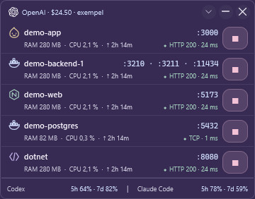

# Otter Monitor


En liten Windows-app för lokala utvecklingsportar och snabbstarter. Byggd i C# / .NET 10 med WPF. Svenskt, minimalistiskt gränssnitt med frostat glas, dämpade plommonfärger, ljusblå accenter och diskreta stoppknappar med fylld symbol och svagt markerad yta. Port- och processlogiken har inga externa bibliotek; appens Billing-session använder Microsofts officiella WebView2-SDK.

## Starta

Kör `build.ps1` och dubbelklicka på **app/OtterMonitor.exe**. Den färdigbyggda Windows x64-versionen innehåller .NET och behöver ingen installation. Kör som vanlig användare. En andra instans öppnas inte.

1. Portlistan uppdateras automatiskt varannan sekund. **Bara utveckling** visar välkända runtime-processer som Node, Bun, Deno, Python och .NET samt Docker-portar. Avmarkera för att se alla lokala lyssnande TCP-portar.
2. Varje **process eller container visas som en grupp** med sina unika portar på samma rad. IPv4- och IPv6-bindningar för samma port visas en gång i sammanfattningen. Dubbelklick på en Node/Bun/Deno-tjänst som svarar över HTTP öppnar webbporten i standardwebbläsaren. Övriga tjänster öppnar en terminal i projektmappen. Håll musen över raden för detaljer.
3. Gruppens **stoppknapp** visar vilken process eller container och vilka portar som berörs innan stoppet utförs.
4. Öppna **⌄ → Snabbstarter…** för att starta och hantera sparade kommandon i ett separat fönster. Lägg till en egen projektmapp och ett kommando, exempelvis `bun run dev`. Nya installationer börjar med en tom snabbstartslista.
5. **Lägg till** och **Redigera** hanterar namn, arbetsmapp och kommando. Kommandon körs i bakgrunden via `cmd.exe /d /s /c`; exempelvis `bun run dev`, `npm run dev`, `dotnet watch` eller `docker compose up -d`.
6. **Logg** visar kommandots utdata. Appen har endast den kompakta portöversikten, även när äldre inställningar anger standardläge. Den är 360 px bred, med minst tre grupprader och 10 px indrag till vänster. Höjden följer listan upp till 342 px, sedan scrollas portarna. Namn och portar delar rad; status, RAM, CPU och körtid visas under. Överraden har klickbart OpenAI-saldo, dragyta, **⌄**, minimera och stäng. Menyn innehåller uppdatering, utvecklingsfilter, fäst överst, snabbstarter och bakgrundsval. Codex/Claude ligger kvar i botten medan portarna scrollas.
7. **Omstartsikonen** bredvid Stoppa startar om en Docker-container. På snabbstartskortet finns samma ikon bredvid Redigera; den aktiveras när kommandot körs. Omstart avslutar hela den tidigare processgruppen innan kommandot körs igen. En öppen loggvy följer med till den nya körningen och äldre loggar bevaras.
8. Körande snabbstarter **återansluts automatiskt** när Otter Monitor öppnas igen och får statusen ”återansluten”. Starta-knappen blir Stoppa, och samma snabbstart kan inte startas dubbelt. Återanslutningen gäller körningar som startats med den här versionen av Otter Monitor.

Inställningar och loggar sparas i `%LOCALAPPDATA%\PortPilot`. `settings.json` innehåller snabbstarterna och kan redigeras när appen är stängd. Föregående inställningsfil sparas som `.bak`. En trasig fil skrivs inte över vid inläsning. Loggfilerna ligger i `logs`; loggvyn visar de senaste 64 kB, hela filen bevaras. `sessions` sparar kopplingen mellan varje snabbstart och dess processgrupp. Behåll dessa filer medan miljöer körs.

## Öppna projektet

**Dubbelklick på en Node/Bun/Deno-rad** öppnar dess lokala webbport i din standardwebbläsare när porten lämnar ett verifierat HTTP-svar. Processens portägarskap och HTTP-svar kontrolleras igen vid klicket. Om gruppen har flera webbportar väljs den med lägst portnummer. Debugger- och HMR-portar väljs inte. HTTP-felsidor kan också öppnas; ett svar som 404 eller 500 är fortfarande en webbsida. Den exakta kontrollerade adressen används, med IPv4 eller IPv6 och HTTP eller HTTPS enligt statuskontrollen.

Om tjänsten saknar ett verifierat HTTP-svar, eller kör en annan runtime, öppnar dubbelklick en ny terminal i projektmappen. Enter på en fokuserad rad gör samma sak. Windows Terminal används när den är tillgänglig, annars öppnas Windows PowerShell. Terminalen kopplas inte till en redan körande extern process och startar inte om servern.

**Högerklick** ger valen **Öppna terminal i projektmappen** och **Öppna i Zed**. Zed hittas i sin vanliga installationsmapp eller via PATH. Otter Monitor följer Zeds inställning för hur projekt öppnas. Radens stopp- och omstartsknappar är separata från dubbelklicket.

För Node/Bun/Deno används den identifierade projektmappen. För andra Windows-processer läses arbetsmappen när du öppnar raden, med kontroll av processens starttid. Docker Compose kan använda containerns etikett `com.docker.compose.project.working_dir` när den pekar på en befintlig lokal Windows-mapp. Om projektmappen saknas visas ett meddelande; ingen godtycklig mapp öppnas.

Integrationerna använder [Windows Terminals kommandoradsgränssnitt](https://learn.microsoft.com/en-us/windows/terminal/command-line-arguments) och [Zeds CLI](https://zed.dev/docs/reference/cli). Sökvägar skickas som separata argument, utan att byggas in i shellkommandon.

## Status och resursvärden

Typetiketter som NODE, DOCKER och TCP har ersatts med små vektorikoner. Håll musen över ikonen för typens namn. Projektnamnen och grupperingen per faktisk process eller container behålls.

Varje grupp visar status med svarstid samt **RAM**, **CPU** och **↑ körtid**. RAM/CPU för Windows-processer mäts varannan sekund för processens verifierade PID och starttid. RAM är arbetsminnet; CPU visar andelen av datorns totala logiska processorkapacitet mellan två mätningar. Det första CPU-värdet är därför `—`. Värdena gäller portens ägarprocess, inte andra processer i projektet.

För Docker används `docker stats --no-stream --no-trunc` ungefär var tionde sekund mot samma lokala motor som portavläsningen. CPU och minne följer Dockers värden; CPU kan överstiga 100 % med flera kärnor. Saknade värden visas som `—` utan att portlistan försvinner. Körtid räknas från processens eller containerns verkliga starttid och följer med en omstart.

Status kontrolleras i bakgrunden ungefär var tionde sekund. Varje unik lokal TCP-port får en anslutningskontroll. Vanliga webbtjänster får också `HEAD /`; om servern svarar 405 provas `GET /` tills svarshuvudena har kommit. Svaret visas som exempelvis **HTTP 200 · 24 ms** eller **HTTP 500 · 61 ms**. Omdirigeringar följs inte. Ingen kropp hämtas och ingen inloggning eller cookie skickas. Endast lokala IP-adresser används; HTTPS-certifikat kringgås inte. Kända debugger- och HMR-portar kontrolleras enbart med TCP.

Grönt betyder att alla kontrollerade TCP-portar svarar och HTTP inte rapporterar fel. HTTP 4xx visas gult och 5xx rött; en 404 på `/` betyder att just den sökvägen saknas och behöver inte betyda att hela applikationen är trasig. **TCP** bekräftar en anslutning, inte applikationens hälsa. Om några portar inte svarar visas exempelvis **1/2 svarar**. Svarstiden är den långsammaste lyckade kontrollen i gruppen; detaljer för varje port finns i muspekartipset. Docker health-statusen `unhealthy`, `starting` eller `paused` visas när den finns. UDP har ingen TCP-svarstid och visas neutralt utan en Docker health-kontroll. Efter 30 sekunder utan ny status visas **Äldre**.

## Codex och Claude Code

Under portlistan visas **procent kvar av abonnemangets kvot** för de kodassistenter som körs i din Windows-session. Programmen delar en fast bottenrad; när programmet avslutas döljs dess rad inom ungefär två sekunder. Ett minimerat program räknas som igång. Håll musen över för hela kvoten, senaste mottagningstid och återställningstider i lokal tid. Låg återstående kvot markeras rosa. Avsaknad av en kvot innebär inte 0 % förbrukning.

**Codex** använder den installerade Codex-klientens dokumenterade [account/rateLimits/read](https://learn.chatgpt.com/docs/app-server) med klientens befintliga inloggning. Otter Monitor hämtar ungefär varje minut medan Codex körs. Klicka på raden för att läsa igen. Ingen modellkörning startas och inga nycklar kopieras. Namngivna kvoter och de tidsfönster kontot faktiskt lämnar används; vissa konton lämnar exempelvis bara en veckokvot. CLI:ns tillfälliga läsprocess stängs efter anropet och räknas inte som en öppen Codex-app.

**Claude-appen som du laddar ner**, inklusive Code-fliken, känns igen även när den är installerad från Microsoft Store. Klicka på Claude Code-raden längst ned och logga in med **samma Claude-konto som i appen**. Otter Monitor öppnar sin egen WebView2-session på [Settings > Usage](https://claude.ai/settings/usage) och läser de synliga procentfälten för aktuell session och veckans gräns för alla modeller. Dölj fönstret när du är klar. Den dolda sidan uppdateras ungefär varje minut medan Claude-appen körs; ingen extra modellförfrågan görs. Användningen gäller kontot, inte en enskild Code-session. Otter Monitor kan inte avgöra vilken flik eller vilket konto som är valt inne i Claude-appen.

Inloggningen använder en separat lokal profil (`claude-profile`). Sessionscookies sparas krypterat med Windows DPAPI i `claude-session.bin` och återställs vid nästa appstart; vanliga cookies sparas av WebView2. Den lokala checkpointen gäller högst sju dagar, och Claude kan kräva ny inloggning tidigare. Inga uppgifter kopieras från den installerade Claude-appen eller din vanliga webbläsare. **Koppla från** tar bort sessionens cookies och checkpoint och stänger av avläsningen. Claude-raden visas bara medan en stödd Claude-process körs. Saknade, tvetydiga och oläsbara procentfält visas som saknade eller äldre värden. Ändringar i webbplatsens layout eller språk kan kräva en uppdatering av läsaren. Återställningstider visas bara om sidan lämnar en entydig maskinläsbar tid.

**Claude Code i terminalen** använder det dokumenterade [rate_limits-fältet i statusraden](https://code.claude.com/docs/en/statusline), med 5-timmars- och 7-dagarsfönster när kontot lämnar dem. När bara terminalversionen körs, klicka på dess kvotrad för att koppla, eller kör `OtterMonitor.exe --install-claude-usage` en gång. Otter Monitor lägger till sin statusrad i `~/.claude/settings.json` (eller `CLAUDE_CONFIG_DIR`) och sparar en backup bredvid filen. Övriga inställningar bevaras. En befintlig egen statusrad skrivs inte över. Den nya statusraden visar samma återstående kvot i terminalen.

Första Claude-värdet kommer efter ett vanligt svar som innehåller kvotdata. Otter Monitor skickar inga Claude-anrop för att få fram det. Claude-kopplingen fungerar utan webbläsare eller separat inloggning; den läser bara JSON som Claude Code själv lämnar till statusraden. Endast procent, tidsfönster, återställningstid och mottagningstid sparas i `%LOCALAPPDATA%\PortPilot\claude-usage.json`. Konversationer, transcript-sökvägar och autentiseringsuppgifter sparas inte. Scriptet ligger bredvid cachefilen som `claude-usage.ps1` och fungerar även när Otter Monitor är stängt. En koppling gäller alla vanliga sessioner som använder den användarinställningen; projektspecifika statusrader kan åsidosätta den. Vid flera konton/sessioner används den senast mottagna kvoten.

Claude-värden äldre än fem minuter och Codex-värden äldre än två minuter markeras **äldre**. När en återställningstid har passerat visas `—` tills ett nytt värde kommer, inte en påhittad full kvot. Saknad Claude-kvot i terminalen kan bero på kontotyp, en äldre klient eller att klienten ännu inte lämnat fältet. Se då Claude Codes egen `/usage`. Windows-installationer av Codex och Claude Code samt deras vanliga Node-installationer känns igen; processer inne i WSL/fjärrmaskiner ingår inte. När både Claude-appen och terminalen körs används den separat anslutna användningssidan för Claude-raden.

Koppla bort med `OtterMonitor.exe --remove-claude-usage`. Det tar bara bort Otter Monitors egen statusrad och lämnar senare inställningsändringar kvar. Om du redan har en egen statusrad behöver du välja vilken du vill använda; Otter Monitor ersätter eller slår inte ihop den automatiskt.

Kvoterna är separata från **OpenAI API-saldot i USD**. Båda visas samtidigt. I kompaktläget ligger **Codex till vänster och Claude Code till höger på samma fasta bottenrad**, med `|` mellan dem när båda körs. **När bara ett program körs fyller dess rad hela bredden**, med namn till vänster och kvot till höger. Bara portlistan scrollas. Håll musen över respektive kvot för fullständig information och återställningstider. Bottenraden ligger kvar även när fönstret ändrar storlek. Om inget program körs tar den ingen plats; portlistan behåller minst tre rader även när båda kvoterna visas.

## OpenAI-saldo

Saldot visas i överraden. **Både OpenAI-loggan och beloppet är klickbara** och öppnar saldokopplingen. Den tomma ytan bredvid fungerar som dragyta. Den vanliga appen läser det sparade saldot från din egen Billing-session; saknade värden visas som väntande. Designförhandsvisningar märks uttryckligen **exempel** och läser inga konton. Saldoknappen öppnar då en informationsdialog med kontofunktionerna avstängda.

Kompaktlägets stoppknappar har en diskret kontursymbol utan färgad platta i viloläget. Rosa markering visas när musen hålls över knappen och tangentbordsfokus har en tydlig kant. Klickytan på 36 × 32 px och extra inre padding behålls. Knappen stoppar hela processgruppen efter bekräftelse.

### Egen session i bakgrunden

1. Välj **Logga in / Öppna Billing**. Otter Monitor öppnar ett eget Billing-fönster med en separat WebView2-session.
2. Logga in på OpenAI och välj rätt organisation. Ingen inloggning, cookie eller token kopieras från Chrome, Edge, Brave eller Codex.
3. När saldot har lästs, välj **Dölj** eller använd Billing-fönstrets kryss. Fönstret försvinner men sessionen fortsätter i bakgrunden. **Dina vanliga webbläsare kan vara helt avstängda.** Även ett minimerat Billing-fönster kan uppdateras.

Billing hämtas på nytt var femte minut när fönstret är dolt eller minimerat och ingen inmatning/dialog är öppen. Ett synligt Billing-fönster eller en pågående inloggning avbryts inte. **Uppdatera saldo nu** hämtar ett nyare saldo direkt. Oförändrad text som bara läses på nytt får inte en förnyad avläsningstid.

**Otter Monitor måste vara igång**, men kan vara minimerat. När Otter Monitor stängs avslutas också dess Billing-session; nästa start återupptar bakgrundsläsningen om den var aktiverad. Ingen Windows-tjänst eller autostart skapas. WebView2:s profil finns i `%LOCALAPPDATA%\PortPilot\billing-profile`.

För att inloggningen ska kunna återställas även efter en fullständig omstart sparar appen också sin egen OpenAI-sessions cookies i `billing-session.bin`, krypterat med Windows DPAPI för din Windows-användare. Detta sker först när ett saldo har lästs, därefter ungefär varje minut och vid vanlig avstängning. Återställningen sker före sidladdningen; befintliga nyare cookies ersätts inte. Endast sessionens OpenAI-domäner ingår. Cookie-egenskaperna bevaras och serverns giltighetstid ändras inte. Ett lokalt checkpoint äldre än sju dagar återställs inte. Inga lösenord sparas eller loggas och inga andra webbläsarprofiler läses.

När sidan återgår till inloggning raderas den sparade sessionen. **Koppla från** stoppar läsaren och raderar `billing-session.bin`, men behåller WebView2-profilen. OpenAI kan fortfarande avsluta eller kräva ny verifiering av en session; öppna då Billing via **OpenAI-loggan** och logga in igen. Efter uppdatering från versionen utan sessionslagring behöver du logga in en gång och vänta tills saldot visas.

Microsoft Edge WebView2 Runtime krävs. Den finns redan på många Windows-datorer; om den saknas visar appen ett fel och portfunktionerna fortsätter fungera. Runtime kan hämtas från [Microsofts officiella sida](https://developer.microsoft.com/en-us/microsoft-edge/webview2/). SDK-licens och NOTICE följer med under `licenses`.

Bakgrundsläsning, dold omhämtning och återställning efter fullständigt avslutad app och WebView2-process verifieras med egna lokala testdata. OpenAI eller din inloggningsleverantör kan kräva ytterligare verifiering eller neka en inbyggd webbläsare; öppna då Billing-fönstret igen.

## Bakgrund och färg

Öppna **⌄** i överraden för verktyg och inställningar. Samma meny finns via högerklick på en tom yta eller kompaktlägets dragyta. **Bara utveckling** och **Fäst överst** visar sina aktuella lägen med bockar.

Under **BAKGRUND** finns fem lägen: **Normal** använder Otter Monitors standardbakgrund, **Opaque** är helt solid i vald färg, **Clear** är genomskinlig utan blur, **Blur** suddar bakomliggande innehåll och **Acrylic** använder Windows glasmaterial. Text och knappar behåller full opacitet. **Visa fönsterram** styr den tunna kanten.

På Windows 11 22H2 och senare använder Blur samma fungerande DWM-backend för frostat glas som Acrylic. Den klassiska accent-blur-effekten används på äldre Windows-versioner. Den har begränsat stöd i nyare Windows 11, vilket även [TranslucentTB beskriver](https://github.com/TranslucentTB/TranslucentTB#features). DWM-materialet är [Desktop Acrylic](https://learn.microsoft.com/en-us/windows/win32/api/dwmapi/ne-dwmapi-dwm_systembackdrop_type). Byten till Clear eller Opaque rensar den tidigare suddeffekten.

**Färg och transparens…** har färgprover, hexkod, RGB-reglage och transparens för färgtonen. Ändringar förhandsvisas direkt. **Spara** behåller dem efter omstart; **Avbryt** återställer utseendet innan dialogen öppnades. Transparensreglaget gäller Clear, Blur och Acrylic. **Återställ utseende** återgår till Acrylic med den ursprungliga plommonfärgen.

OpenAI-knappen visar Blossom-loggan som vit vektor. Ursprung och varumärkesinformation finns i `licenses/OpenAI-logo-NOTICE.txt`.

## Beteende

- Windows 11 22H2 eller senare använder **Desktop Acrylic** via DWM: skrivbordets och bakomliggande fönsters färger suddas genom glasyta och halvtransparenta paneler. Text och ikoner behåller full opacitet. Ingen bakgrundsbild bakas in i appen. Dialoger och loggfönster använder samma material och färgpalett.
- Materialet följer Windows inställning för transparenseffekter. Om den är avstängd, högkontrast används eller Acrylic saknar stöd visas en mörk, täckande reservyta. Windows kan också göra materialet mer täckande vid exempelvis inaktivt fönster eller energisparläge. Inställningar i Windows ändras inte av appen.
- Lokal portavläsning täcker lyssnande **TCP**, IPv4 och IPv6. Portar samlas per faktisk ägare: PID och starttid för Windows-processer, container-ID och lokal Docker-endpoint för containrar. Processer med samma namn men olika PID hålls isär och visar PID i gruppen. TCP och UDP med samma nummer hålls isär. Översiktens antal räknar unika portnummer/protokoll, även när listan är filtrerad.
- **Node, Bun och Deno visar projektets namn** i portöversikten. Appen läser processens arbetsmapp och söker efter närmaste `package.json`; dess `name` används, annars projektmappens namn. En sökväg i processens argument kan också identifiera projektet, och paket under `node_modules` namnges efter appen som äger dem. Informationen läses utan att köra projektkod och uppdateras ungefär var tionde sekund. Om processinformationen inte kan läsas visas runtime-namnet som tidigare.  Visningsnamnet ändrar inte PID, processens starttid eller stoppets mål; flera processer med samma projektnamn hålls isär.
- Utvecklingsfiltret bygger på processnamn. Egna kompilerade serverprogram kan behöva visas med filtret avstängt.
- Docker kräver Docker CLI och en igångvarande lokal Docker-motor via Windows named pipe, exempelvis Docker Desktop. Både publicerade TCP- och UDP-portar visas. Exponerade containerportar utan värdbindning visas inte. Docker kontrolleras ungefär var tionde sekund, separat från TCP-avläsningen. Fjärrkontexter hoppas över.
- Docker stoppas med `docker stop --time 10` och startas om med `docker container restart --timeout 10`, mot samma lokala endpoint och fullständiga container-ID som lästes in. Appen stoppar inte Docker Desktop självt. Om CLI-anropet får timeout kan Docker fortfarande slutföra åtgärden; uppdatera portlistan för aktuell status.
- Vanliga processer avslutas med sina underprocesser. Detta är ett påtvingat stopp, inte Ctrl+C. Processens starttid och portägarskap kontrolleras igen före stopp. Windows-systemprocesser och Dockers vidarebefordrande processer skyddas. Åtkomstfel visas utan automatisk administratörshöjning. En extern watcher kan starta en process igen.
- Snabbstarter spåras med Windows Job Objects, även om startkommandot avslutas före en underprocess. **Stoppa** avslutar hela den spårade processgruppen. Tjänster och Docker-containrar som ett kommando startar frikopplat, exempelvis `docker compose up -d`, måste stoppas via portlistan eller ett separat kommando.
- När Otter Monitor stängs fortsätter startade processer att köras. En dold `PortPilot.LaunchHost` håller processkopplingen vid liv och avslutas när miljön avslutats. Den fristående appen sparar en delad kopia av hjälpprogrammet per appversion i `runtime`, så att den portabla exe-filen kan uppdateras även när miljöer körs. Ingen Windows-tjänst eller autostart installeras.
- Återanslutning använder en namngiven Windows-processgrupp, aldrig en gissning utifrån processnamn eller port. Den fungerar även om startkommandot har avslutats men barnprocesser körs. Äldre körningar från tidigare appversioner och manuellt startade terminalkommandon visas via portlistan men kopplas inte automatiskt till en snabbstart. Dubblettskyddet gäller samma sparade snabbstart, inte liknande kommandon med olika snabbstarts-ID.
- Omstart kontrollerar arbetsmapp och kommando före stopp och väntar sedan på att den tidigare processgruppen avslutas. Knappar låses under pågående åtgärder. Okänd avslutningskod efter återanslutning visas som ”Avslutad · se logg”; felkod från en körning som startats i den aktuella appsessionen visas som ”Misslyckades · kod …”. Vid problem med sparad processkoppling startas ingen ny körning, och **Försök igen** försöker återansluta.
- Interaktiva terminalprogram som kräver inmatning stöds inte i bakgrundskörningen. Appen har ännu ingen systemfältsikon, Windows-autostart eller UDP-lista för vanliga Windows-processer.
- Alltid överst gäller vanliga skrivbordsfönster, inte Windows säkerhetsskrivbord eller alla exklusiva helskärmslägen.

## Bygga och testa

Windows och .NET 10 SDK krävs för källkoden. Den färdigbyggda appen behöver inte SDK:t.

```powershell
dotnet build src/PortPilot.App/PortPilot.App.csproj -c Release
dotnet run --project tests/PortPilot.Tests/PortPilot.Tests.csproj -c Release -- "$env:TEMP\Otter Monitor-tests"
.\build.ps1
```

`build.ps1` publicerar en fristående x64-exe i `app`. Den första publiceringen kan hämta Microsofts runtimepaket från NuGet. WPF trimmas inte.

Testprogrammet skapar egna tillfälliga TCP-servrar. Det testar riktiga IPv4/IPv6-bindningar, PID-skydd, stopp och omstart på samma port, återanslutning efter att den startande processen avslutats, dubbelstart, kommandologgar, arbetsmappar, inställningar samt Docker-JSON och filtrering av fjärranslutningar. Projektupptäckten kontrolleras med paketnamn, undermappar, beroendepaket, felaktiga metadata och separata processägare. Docker-omstart kontrolleras med en separat test-CLI, inklusive argument, endpoint, kontext och felhantering. Det stoppar inga befintliga användarservrar eller containrar.

För att även testa den paketerade appens hjälpprocess, ge testprogrammet två argument: en absolut resultatmapp och den absoluta sökvägen till `app\OtterMonitor.exe`. Vanlig körning omfattar 52 tester, med den paketerade exe-filen 53. Sätt miljövariabeln `PORTPILOT_TEST_NODE` till den absoluta sökvägen till `node.exe` för ytterligare ett integrationstest: en egen Node-server i en projektmapp med mellanslag upptäcks via sin verkliga arbetsmapp, får rätt projektnamn och stoppas med bibehållen processidentitet. Resurstesterna kontrollerar verkligt processminne, CPU över ett tidsintervall och skydd mot återanvända PID. En separat test-CLI kontrollerar Docker stats-argument och minnesenheter. Lokala HTTP/TCP-fixturer kontrollerar svarstid, HEAD/GET, felkoder, partiellt svarande grupper, timeout, omdirigeringar och avbrytning. Utvecklingsbyggen som inte är fristående använder sin vanliga exe som hjälpprogram; stoppa snabbstarterna innan dessa byggfiler ersätts.

UI-kontroller och en rendering med tydligt märkt exempeldata kan köras utan att läsa användarens inställningar:

Projektnavigeringen testas genom egna processer som registrerar mottagna argument och arbetsmapp, inklusive mellanslag, Unicode och shelltecken. Reservterminalens arbetsmapp kontrolleras med en riktig dold PowerShell-process. WPF-kontrollerna verifierar namn/portars position, dubbelklickets mål, åtskillnad från stoppknappar och att högerklicksmenyn byter projekt med raden. Tester öppnar inte användarens Zed-projekt eller interaktiva terminalfönster.

```powershell
.\app\OtterMonitor.exe --preview --verify-ui --report ui-report.txt --output preview.png
.\app\OtterMonitor.exe --preview --compact --output compact.png
.\app\OtterMonitor.exe --preview --empty --output empty.png
.\app\OtterMonitor.exe --preview --dialog --output dialog.png
.\app\OtterMonitor.exe --preview --balance-dialog --output balance-dialog.png
.\app\OtterMonitor.exe --preview --group-example --output grouped.png
.\app\OtterMonitor.exe --preview --group-example --expanded --output grouped-details.png
```

`--capture-live --output live.png` renderar aktuell portavläsning utan att starta eller stoppa några miljöer och utan att ändra inställningarna.

PNG-förhandsvisningarna visar reservytan, eftersom WPF:s bildrendering inte kan fånga DWM:s bakgrundsoskärpa. Granska verkligt glas utan att påverka dina miljöer med `--preview --compact --group-example --glass --stay-open`. `--material-report material.txt` sparar Windows-version, DWM-materialets och ramritningens återlästa värden, fönstrets aktivering och transparensstatus. Förhandsvisningen använder exempeldata och stängs med krysset.

Saldoläsarens fyra JavaScript-tester körs med Node: `node --test tests/OpenAiBalanceReader/reader.test.cjs`. De kontrollerar beloppsformat, rätt Billing-sida, det exakta saldokortet, varningar med $0 och tvetydiga eller oläsbara fält. Kärntesterna kontrollerar även lokal saldolagring, fel, färskhet och kompatibilitet med äldre inställningar.

## Struktur

- `src/PortPilot.Core`: portavläsning, Docker, processgrupper, resursmätning, tjänstkontroller och inställningar.
- `src/PortPilot.App`: WPF-fönster, dialoger och loggvisning.
- `tests/PortPilot.Tests`: körbara integrationstester utan externa testpaket.
- `tests/OpenAiBalanceReader`: tester för appens inbäddade DOM-läsare.
- `tests/ClaudeUsageReader`: tester för Claude-dialogens kvotfält, nästlade rubriker, procentformat och avgränsning från modellkvoter/krediter. Kör med `node --test tests/ClaudeUsageReader/reader.test.cjs`. Samma layoutfall verifieras också i riktig WebView2 med `--verify-claude-browser --test-root <egen testmapp> --report <rapportfil>`.

Tekniska referenser: [Windows TCP-tabeller](https://learn.microsoft.com/en-us/windows/win32/api/iphlpapi/nf-iphlpapi-getextendedtcptable), [Windows Job Objects](https://learn.microsoft.com/en-us/windows/win32/procthread/job-objects), [Docker container ls](https://docs.docker.com/reference/cli/docker/container/ls/), [Docker inspect](https://docs.docker.com/reference/cli/docker/inspect/), [Docker restart](https://docs.docker.com/reference/cli/docker/container/restart/), [Windows Acrylic](https://learn.microsoft.com/en-us/windows/apps/design/style/acrylic), [DWM-systemmaterial](https://learn.microsoft.com/en-us/windows/win32/api/dwmapi/ne-dwmapi-dwm_systembackdrop_type).

Resursmätning: [Process.WorkingSet64](https://learn.microsoft.com/en-us/dotnet/api/system.diagnostics.process.workingset64), [Windows Process-implementation](https://github.com/dotnet/runtime/blob/main/src/libraries/System.Diagnostics.Process/src/System/Diagnostics/Process.Windows.cs), [Docker stats](https://docs.docker.com/reference/cli/docker/container/stats/).


Den dolda WebView2-sessionen kan integrationstestas på lokala testdata med `app\OtterMonitor.exe --verify-background --test-root C:\temp\Otter Monitor-test-profile --report C:\temp\Otter Monitor-background-report.txt`. Testet kontaktar inget OpenAI-konto och behöver ingen inloggning. Det testar riktig dold DOM-avläsning, automatisk omhämtning, avvisning av varningar och återförsök vid lagringsfel.

Bakgrundssession: [WebView2:s dolda vy](https://learn.microsoft.com/en-us/dotnet/api/microsoft.web.webview2.core.corewebview2controller.isvisible), [lokal profil](https://learn.microsoft.com/en-us/microsoft-edge/webview2/concepts/user-data-folder), [officiellt SDK](https://www.nuget.org/packages/Microsoft.Web.WebView2/1.0.4258.31).

Sessionsåterställning verifieras med `--verify-billing-session --test-root <egen testmapp> --session-phase seed --report <rapportfil>` och därefter `probe` med samma testmapp i en ny app-process. `--baseline` visar beteendet utan checkpoint: vanliga cookies kvarstår men sessionscookies försvinner. `revoke` och sedan `probe-revoked` kontrollerar att en utloggad session inte återställs. Testet använder endast syntetiska cookies och lokal HTML, blockerar alla externa testförfrågningar och väntar på att hela WebView2-processen avslutas. Lagringen använder [Windows ProtectedData/DPAPI](https://learn.microsoft.com/en-us/dotnet/api/system.security.cryptography.protecteddata?view=net-10.0).

Appen hette tidigare PortPilot och DevGeek. Datamappen `%LOCALAPPDATA%\PortPilot` behålls för sparade kommandon, loggar och inloggningar. Den äldre exe-sökvägen är en kompatibilitetslänk till samma programfil.

## Ikon

Appens logga är en orange utter med turkos fisk och transparent bakgrund, utformad med imagegen utifrån den medföljande referensbilden. Loggan finns i `assets/otter-mark.png`, referensen i `assets/otter-logo.png` och Windows-ikonen i `src/PortPilot.App/otter-monitor.ico`. Genereringsprompten finns i `assets/otter-mark.prompt.txt`. Återskapa ICO med `python tools/build-icon.py` (Pillow krävs endast för detta verktyg); transparensen bevaras i alla nio ikonstorlekar.

## Förhandsvisning



Källkoden innehåller inga användarkonton, profiler eller lokala snabbstartsinställningar. Kontovärden i förhandsvisningen är syntetiska. OpenAI- och Claude-inloggningar görs lokalt av varje användare.
